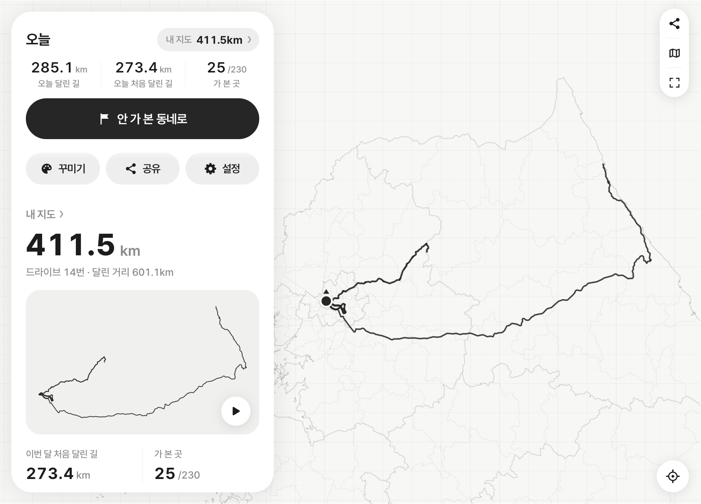
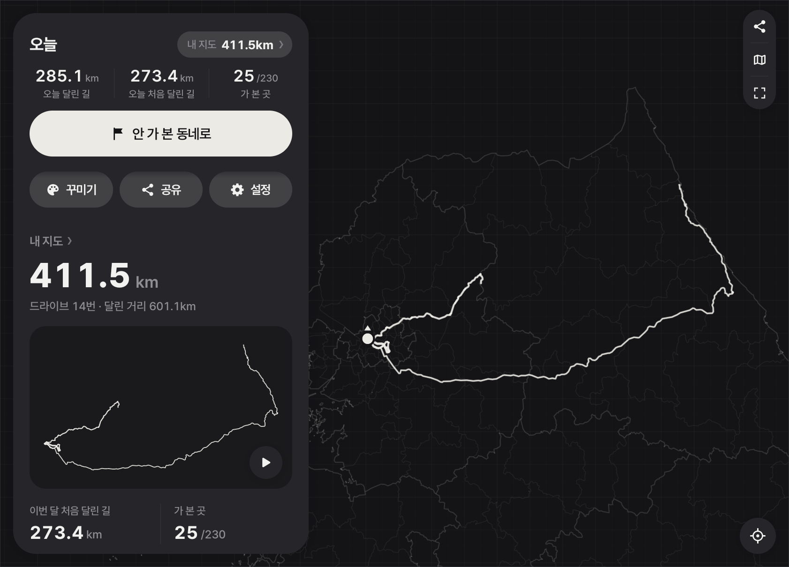
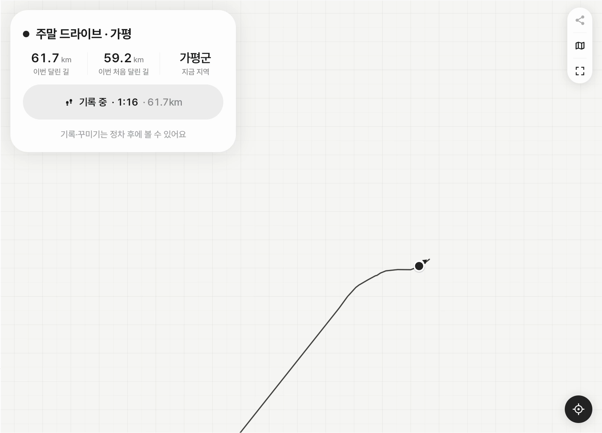
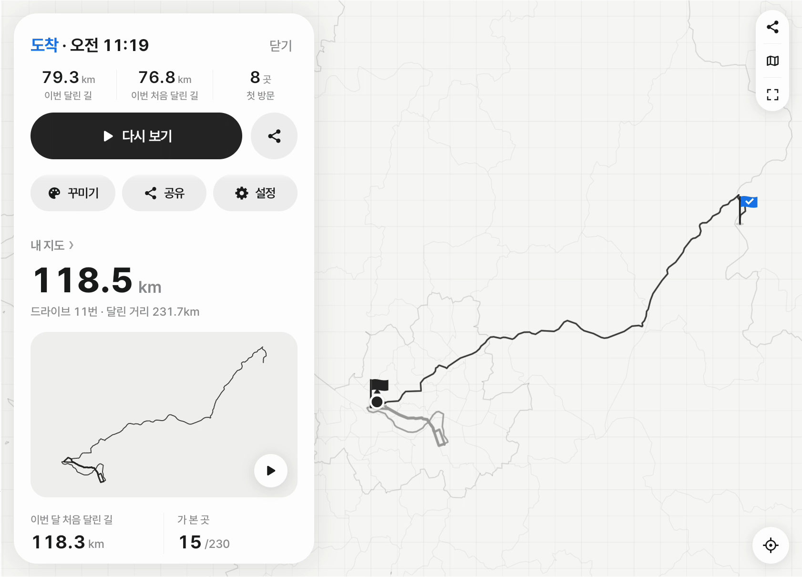
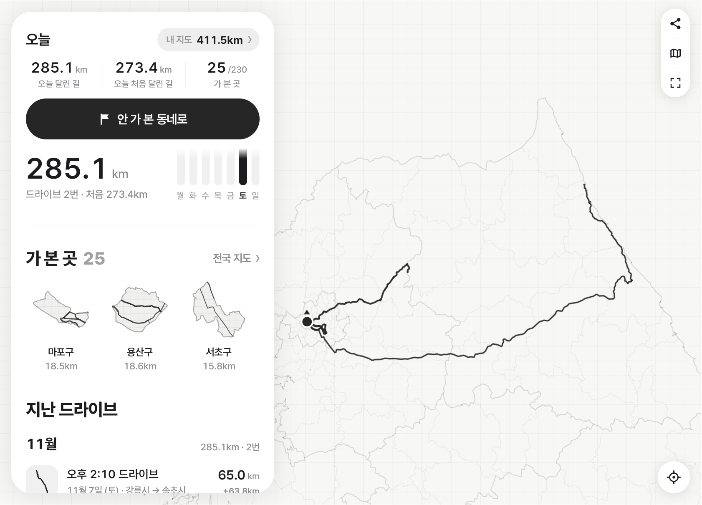
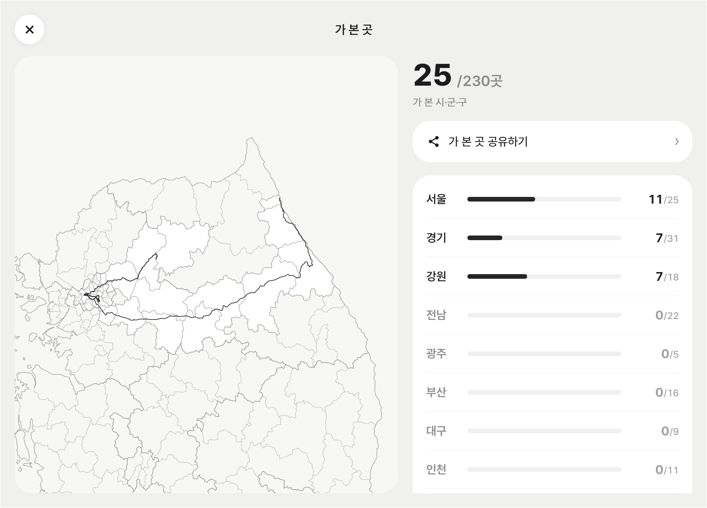
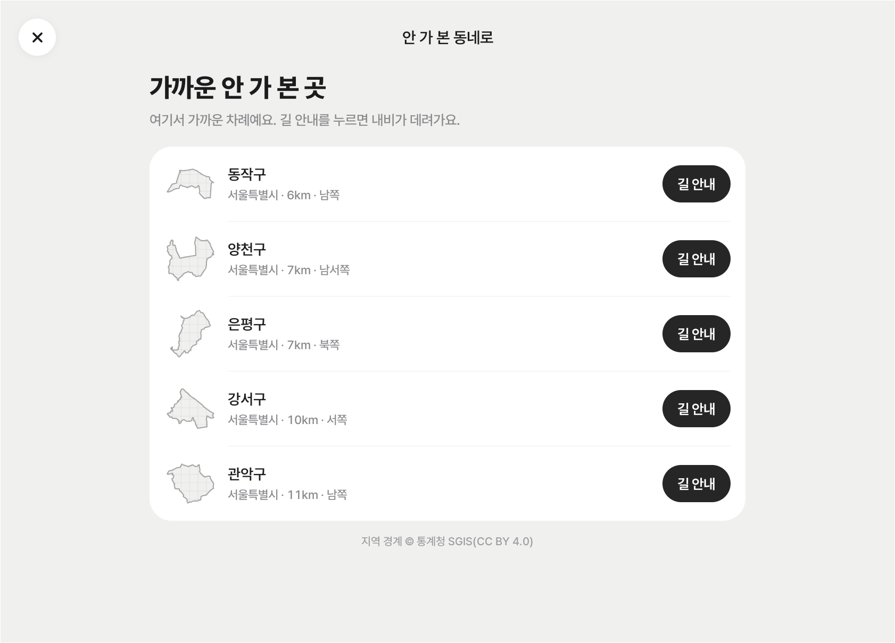
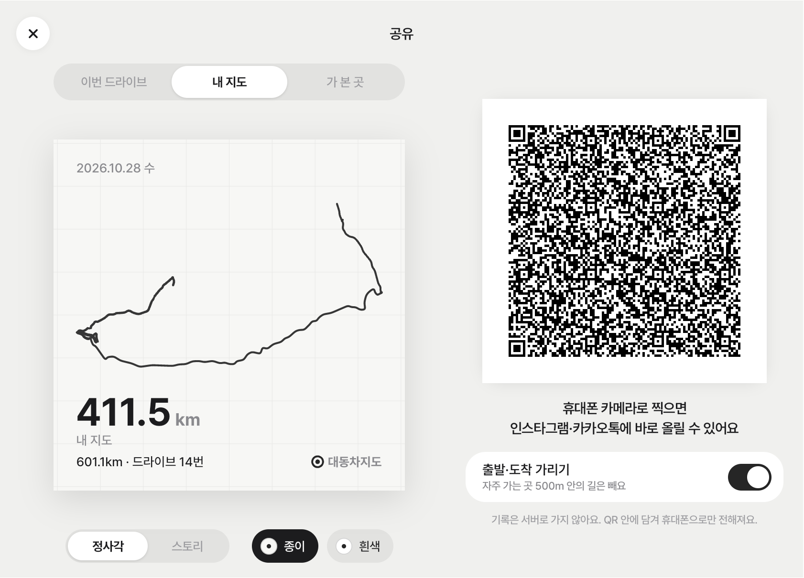
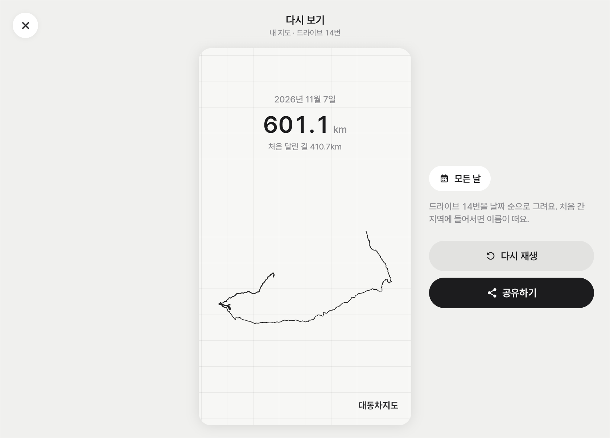
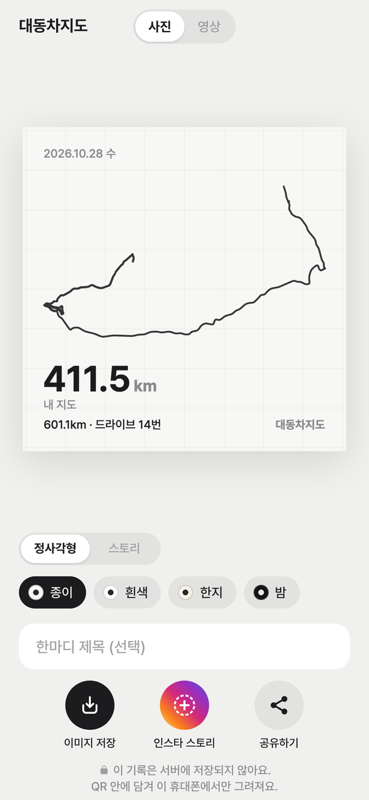

# 대동차지도

**차가 달린 경로를 자동으로 기록해 한 장의 지도에 그리고, 처음 달린 도로의 길이와 처음 들어간 시·군·구(전국 230곳 기준)를 세는 Pleos Connect 앱.**

이름은 대동여지도(김정호, 1861)의 '여(輿, 수레)'를 '차(車)'로 바꾼 것이다. 내 차로 달린 도로만으로 그리는 지도라는 뜻이다.

| | |
|---|---|
| 소개 페이지 · QR 공유 카드 뷰어 | https://geunbongit.github.io/daedongchajido/ |
| 시연 영상 (1분 56초) | https://geunbongit.github.io/daedongchajido/assets/demo.mp4 · 저장소 파일 [`web/assets/demo.mp4`](web/assets/demo.mp4) |
| 숏폼 (세로, 54초) | [`web/assets/shortform.mp4`](web/assets/shortform.mp4) |
| 설치 파일 (APK) | 저장소 [`apk/편재식_대동차지도_release.apk`](apk/) · [최신 릴리스](https://github.com/geunbonGit/daedongchajido/releases/latest)의 `daedongchajido_release.apk` |
| 기획서 · 디자인 | [docs/proposal.md](docs/proposal.md) · [docs/design.md](docs/design.md) |



---

## 기능

### 1) 자동 주행 기록
- 기어가 D로 바뀌면 1초 간격으로 위치 기록을 시작하고, P로 바뀌면 기록을 멈춘 뒤 그 드라이브의 경로, 주행 거리, 처음 달린 거리, 지나간 시·군·구를 저장한다.
- 운전자가 누르는 버튼은 없다. 기어 신호를 받을 수 없는 차에서는 시속 5km 이상으로 10초 달리면 시작하고, 3분 동안 멈춰 있으면 끝낸다.
- 차량 API: Pleos Vehicle SDK의 기어 신호, AAOS `CarPropertyManager`의 `GEAR_SELECTION`·`PERF_VEHICLE_SPEED`, Pleos FusedLocation SDK의 위치(1초 간격). 기록은 포그라운드 서비스에서 한다.

### 2) 내 도로 지도
- 저장한 모든 드라이브의 경로를 한 장의 지도에 그린다.
- 같은 도로를 다시 달리면 선을 새로 긋지 않고 기존 선에 합친다. 왕복 차로(최대 약 30m 간격)는 한 줄로 그린다.
- 선 굵기는 그 도로를 지난 횟수로 정한다: 1회, 2회, 3~4회, 5~8회, 9회 이상의 5단계.
- 터널처럼 GPS가 끊긴 구간은 3km·5분 이내면 직선으로 잇는다.

### 3) 처음 달린 길
- 드라이브마다 지도에 없던 도로를 달린 거리를 따로 계산한다. 예: "오늘 42.1km 중 처음 달린 길 12.4km"
- 같은 출퇴근길을 다시 달리면 처음 달린 길은 0km다. 시연 주행 검증: 같은 출근길 둘째 날 0km, 다른 다리로 돌아간 날 20.4km(실제 다른 구간 20.4km와 일치).

### 4) 시·군·구 방문 기록
- 통계청 행정구역 경계로 만든 전국 230개 시·군·구 경계를 앱에 넣었다. 한 지역 안에 30초 이상 있으면 방문으로 기록한다(경계 도로에서 지역이 번갈아 잡히는 것을 막는 조건).
- 화면에 "가 본 곳 25 / 230"처럼 방문한 지역 수와 시·도별 방문 수, 지역별 방문 날짜·달린 거리를 표시한다.
- 주행 중 처음 들어간 지역이면 음성으로 알린다: "양양군, 처음 와 보는 곳이에요."

### 5) 안 가 본 동네로
- 지금 위치에서 200km 안에 있는, 아직 방문하지 않은 시·군·구 5곳을 직선거리 순으로 보여 준다(거리·방향 표시).
- '길 안내'를 누르면 그 지역의 대표 지점을 목적지로 Pleos 내비게이션에 경로 요청(NaviHelper SDK `requestRoute`)을 보낸다. 공식 Pleos 에뮬레이터에서 내장 내비게이션이 경로 3개를 띄우는 것을 확인했다.

### 6) 도착 요약 · 다시 보기
- P로 바뀌면 화면에 이번 주행 거리, 처음 달린 길, 처음 방문한 지역 목록을 표시하고, "오늘 처음 달린 길 12.4킬로미터"처럼 음성으로 읽는다.
- 다시 보기: 드라이브 하나, 지역 하나, 또는 전체 기록을 달린 순서대로 다시 그리는 애니메이션(3.5~12초)을 재생한다.

### 7) QR 공유 (서버 없음)
- 공유 카드 3종(이번 드라이브 / 내 지도 / 가 본 곳)을 화면에 QR로 표시한다. 경로와 숫자를 1KB 이하(데이터 561바이트 이하, QR 버전 20 이하)로 압축해 QR 주소 `https://geunbongit.github.io/daedongchajido/s/#…`의 '#' 뒤에 넣는다.
- 휴대폰 카메라로 QR을 찍으면 공유 페이지가 열리고, 휴대폰 브라우저가 '#' 뒤 데이터로 카드 이미지(정사각 1080×1080 또는 스토리 1080×1920)를 그린다. 이미지는 공유 버튼으로 인스타그램·카카오톡에 보낸다.
- 브라우저는 '#' 뒤 내용을 서버로 보내지 않으므로, 기록 데이터는 어떤 서버에도 전송·저장되지 않는다.
- 출발 지점과 도착 지점에서 300m 안의 경로는 카드에서 지운다(집·회사 위치 노출 방지, 기본 켬).

### 8) 지도 배색 · 밤 모드
- 지도와 화면 배색 17가지 중 하나를 고른다. '자동'이면 차가 야간 모드일 때 어두운 배색으로 바뀐다.
- '꾸미기'에서 선 모양 6가지 중 하나를 고르고, '실제 지도' 버튼으로 OpenFreeMap 도로 지도를 겹친다(이 기능만 인터넷을 쓴다).

### 주행 중 화면 제한
- 주행 중(Pleos 주행 규제 상태, `CarUxRestrictionsManager`)에는 기록 목록, 공유, 다시 보기, 배색 변경을 막고, 누르면 "정차 후에 볼 수 있어요"를 표시한다.
- 주행 중 화면에는 숫자 3개(이번 달린 길, 이번 처음 달린 길, 지금 지역)와 지도만 표시한다. 주행 중 안내는 음성으로만 한다.

### 개인정보
- 위치 기록은 차량 저장 공간에만 저장하고 외부로 전송하지 않는다. 서버, 계정, 분석 도구가 없다. `allowBackup=false`.
- 드라이브 화면의 '기록 지우기'로 드라이브 하나를, 설정의 '기록 모두 지우기'로 전체 기록을 지운다. 드라이브 하나를 지우면 남은 기록으로 지도와 숫자를 다시 계산한다.
- 공유 카드에서 지우는 범위: 드라이브 카드는 출발·도착에서 경로를 따라 300m와 직선 300m 안의 선, 내 지도 카드는 출발·도착 지점이 가장 많이 모인 2곳에서 500m 안의 선. 형식: [docs/share-format.md](docs/share-format.md).
- 공유 페이지는 `default-src 'self'` 보안 정책(CSP)으로 다른 사이트에 요청하지 않는다. GitHub Pages 서버가 받는 요청은 페이지 파일 요청뿐이다.

## 화면

Pleos Connect 에뮬레이터(2560×1440)의 앱 창(1682×1210)을 잘라낸 화면이다.

| | |
|---|---|
|  첫 화면 — 모든 드라이브의 경로, 오늘 달린 거리, 오늘 처음 달린 거리, 가 본 곳 수 |  '자동' 배색에서 차가 야간 모드일 때 |
|  주행 중 — 숫자 3개와 지도만 표시 |  P로 바꾼 뒤 — 이번 79.3km, 처음 달린 길 76.8km, 첫 방문 8곳 |
|  기록 — 내 지도 · 이번 주 · 지역 · 지난 드라이브 목록 |  가 본 곳 — 230개 시·군·구 지도와 시·도별 방문 수 |
|  안 가 본 동네로 — 200km 안 미방문 지역 5곳, '길 안내' → Pleos 내비게이션 |  QR 공유 — 카드 미리보기와 QR |
|  다시 보기 — 전체 기록을 달린 순서대로 다시 그림 |  QR을 찍은 휴대폰 — 카드 저장 · 인스타 스토리 · 공유 버튼 ([스토리 카드](docs/screens/card-story.png)) |

---

## 실행 방법 (심사용)

### 1. Pleos Connect 에뮬레이터 설치

1. Android Studio → **Settings → Languages & Frameworks → Android SDK → SDK Update Sites** 에서 `+`로 사이트를 추가한다.
   - Apple Silicon(arm64): `https://nexus-playground.pleos.ai/repository/raw-releases/connect-avd/2.x/crp-arm64-sys-img.xml`
   - Intel/AMD(x86_64): `https://nexus-playground.pleos.ai/repository/raw-releases/connect-avd/2.x/crp-sys-img.xml`
2. **SDK Platforms** 탭에서 *Show Package Details* → Android 14 (API 34) 아래 **Pleos Connect v2.1.0 APIs** 시스템 이미지를 설치한다(라이선스 동의 필요).
3. **Device Manager → Create Virtual Device** → 기기 *Pleos Connect* (2560×1440, 160 dpi) → 시스템 이미지 *Pleos Connect v2.1.0 APIs (API 34)* →
   Advanced: **RAM 4 GB**, Boot option **Cold boot** 로 만든다. (이 저장소는 AVD 이름 `Pleos_Connect`로 검증했다.)
4. 에뮬레이터를 켜고 홈 화면이 뜰 때까지 기다린다.

### 2. APK 설치와 실행

```sh
adb install -r apk/편재식_대동차지도_release.apk
```

앱 목록에서 **대동차지도**를 연다(또는 `adb shell am start --user 10 -n com.odomap.app/.ui.MainActivity` — Pleos Connect의 운전자 사용자 번호는 10).
처음 열 때 위치·알림 권한을 허용한다. 권한 대화상자를 건너뛰었으면 아래 명령으로 허용한다.

```sh
for p in android.permission.ACCESS_FINE_LOCATION android.permission.ACCESS_COARSE_LOCATION android.permission.POST_NOTIFICATIONS android.car.permission.CAR_SPEED; do
  adb shell pm grant --user 10 com.odomap.app $p; done
```

### 3. 시연 주행으로 확인하기

에뮬레이터는 실제로 달리지 않는다. 그래서 실제 도로를 따라 만든 **시연 주행 14개**(출퇴근 10개 · 가평 왕복 2개 · 강릉 여행 · 동해안, 총 약 600km)를 앱에 넣었다.

1. 화면 아래 판 머리의 **'오늘'을 길게 누르면**(넓은 창에서는 왼쪽 판 맨 위) 시연 패널이 열린다. **설정 › 시연 패널**로도 연다. 재생 중에는 판 머리의 드라이브 이름을 길게 눌러 패널을 열고 '멈춤'을 누른다.
2. **모두 차례로** — 14개를 날짜 순으로 재생한다. 빠르기는 1×·10×·30×·60× 중 고르고 기본은 60×다(60×로 14개 약 15~20분). 한 줄을 누르면 그 드라이브 하나만 재생한다(가평 드라이브 60×로 약 2분).
   재생 중에도 실제 주행과 같은 코드로 기록·저장·음성 안내가 실행된다.
3. **시연 중 주행 화면 제한 풀기** — 켜면(기본) 재생 중에도 모든 화면이 열린다. 끄면 실제 차와 같이 주행 중 제한 화면(숫자 3개 + 지도)이 나온다.
4. 재생이 끝나면 도착 요약 → **다시 보기**, 판 아래 **기록 · 가 본 곳(전국 지도)**, 오른쪽 위 **공유(QR)** 를 누른다.
   QR을 휴대폰 카메라로 찍으면 `https://geunbongit.github.io/daedongchajido/s/#…` 페이지에 카드가 그려진다.
5. **안 가 본 동네로** — 현재 위치에서 200km 안의 지역을 고르므로, 먼저 에뮬레이터 위치를 서울로 옮긴다.
   ```sh
   adb emu geo fix 126.9246 37.5563     # 경도 위도 — 홍대입구역 근처
   ```
   지역의 **길 안내**를 누르면 NaviHelper가 Pleos 내비게이션에 경로를 요청하고, 내비게이션이 경로를 띄운다.
6. 시연 패널의 **전체 삭제**를 누르면 모든 드라이브와 지도가 지워져 설치 직후 상태가 된다.

밤 배색 확인: `adb shell cmd uimode night yes` (되돌리기 `no`). 꾸미기에서 배색이 '자동'이면 어두운 배색으로 바뀐다.

## 테스트 환경과 필요한 설정

| 항목 | 값 |
|---|---|
| 검증한 기기 | 공식 Pleos Connect 에뮬레이터 v2.1.0 (Android 14 / API 34, `android-automotive`, arm64, 2560×1440 160 dpi, RAM 4 GB), 운전자 사용자 10 |
| 앱 | `com.odomap.app` 0.1.0 (versionCode 1), minSdk 28(Android 9), target/compile 35, ABI arm64-v8a · x86_64 |
| 빌드 도구 | Android Studio (번들 JBR 21) 또는 JDK 17 이상, Gradle 8.10.2(wrapper), AGP 8.8.2, Kotlin 2.0.21, Compose BOM 2025.01.01 |
| 권한 | 위치(`ACCESS_FINE/COARSE_LOCATION`), 포그라운드 서비스(`FOREGROUND_SERVICE_LOCATION`), 알림, 부팅 후 시작, Pleos `FUSED_LOCATION` · `CAR_SPEED` · `CAR_DRIVE` · `CAR_INFO` · `CAR_MILEAGE` · `NAVI_ROUTE` · `NAVI_ROUTE_SEARCH`, AAOS `CAR_POWERTRAIN` · `CAR_SPEED`, 인터넷('실제 지도' 겹치기에만 사용. 기록·종이 지도·공유는 인터넷 없이 동작) |
| 네트워크 | 차에는 필요 없다. 공유 QR을 열 때 휴대폰이 GitHub Pages에서 정적 페이지 파일을 받는다. |

### 직접 빌드

```sh
export JAVA_HOME="/Applications/Android Studio.app/Contents/jbr/Contents/Home"
echo "sdk.dir=$HOME/Library/Android/sdk" > local.properties     # 처음 한 번
./gradlew :core:test :app:testDebugUnitTest                      # 테스트 (core 172개 + app 6개)
./gradlew :app:assembleDebug                                     # 디버그 APK
./gradlew :app:assembleRelease                                   # release APK (R8 + 리소스 축소)
node --test web/test/                                            # 웹 뷰어 테스트 15개
```

Release 서명 정보는 저장소 밖 `~/.odomap/keystore.properties`(`storeFile`, `storePassword`, `keyAlias`, `keyPassword`)에서 읽는다(`-PodomapKeystoreProps=경로`로 위치를 바꾼다).
이 파일이 없으면 서명하지 않은 release APK를 만들고 경고를 출력한다. 키스토어와 비밀번호는 저장소에 넣지 않는다.

## APK 위치

`apk/편재식_대동차지도_release.apk` — release 빌드(R8 난독화·축소 + 리소스 축소, APK Signature Scheme v2 서명, 21.3 MB, arm64-v8a · x86_64).
같은 파일을 [최신 릴리스](https://github.com/geunbonGit/daedongchajido/releases/latest)에 `daedongchajido_release.apk`로 올렸다.

## 사용한 Pleos SDK · AAOS API

| SDK / API | 버전 | 용도 (코드 위치) |
|---|---|---|
| **Pleos FusedLocation** (`ai.pleos.playground:FusedLocation`) | 1.1.3 | `registerFusedLocationCallback` — 1초 간격 위치 수신. 서비스가 없으면 Android `LocationManager` 사용 (`location/`) |
| **Pleos Vehicle** (`ai.pleos.playground:Vehicle`) | 2.3.2 | 기어 상태 `getGear().registerGearSelection` — 기록 시작·종료 판단 (`drive/CarDriveStateSources.kt`) |
| **Pleos NaviHelper** (`ai.pleos.playground:NaviHelper`) | 3.0.5 | `requestRoute` — '안 가 본 동네로' 길 안내, 오류 코드별 안내 문구 (`navi/Navi.kt`) |
| AAOS `CarPropertyManager` | `android.car` | `GEAR_SELECTION`(우선), `PERF_VEHICLE_SPEED` — Pleos 서비스가 없을 때 같은 판단. 둘 다 없으면 속도 규칙(`SpeedDriveDetector`: 시속 5km 이상 10초 → 시작, 정지 3분 → 끝) |
| AAOS `CarUxRestrictionsManager` | `android.car` | 주행 중 화면 제한(`distractionOptimized` 앱) — 목록·꾸미기·공유·다시 보기를 정차 후에만 연다 |
| Android `TextToSpeech` | — | 첫 방문 지역·도착 요약 음성 안내. Pleos TextToSpeech SDK가 공개되면 교체한다 |

SDK 저장소: `https://nexus-playground.pleos.ai/repository/maven-releases/` (`settings.gradle.kts`). `android.car`는 `required=false`로 선언해 일반 Android 기기·에뮬레이터에서도 앱이 실행된다.

---

## 구조와 기술

```
:core  순수 Kotlin/JVM 엔진 (android.* 없음)     :app  Android 앱 (Compose + MapLibre)
 ├ geo     거리 계산, JS와 같은 hypot/round      ├ location  Pleos FusedLocation → Android LocationManager 대체
 ├ run     칼만 필터 + RTS 보정, 도플러 검사       ├ drive     기어(AAOS → Pleos) → 속도 규칙 순으로 주행 상태 판단
 ├ explore 도로 선 합치기, 처음 달린 길, z14 타일  ├ record    포그라운드 서비스 + DriveRecorder(엔진 스레드 1개)
 ├ car     CarProfile — 차량용 규칙 값             ├ store     기기 저장: z14 타일 JSON + 드라이브 폴더
 ├ region  시·군·구 230곳 판정·진입 추적·추천      ├ ui        홈 · 주행 · 도착 · 기록 · 드라이브 · 전국 지도 · 공유 · 다시 보기 · 꾸미기 · 시연 패널
 └ share   QR 공유 카드 인코더(qrcodegen)          └ engine, model, replay(시연 재생), share, navi, tts, ux(주행 제한)
web/   GitHub Pages 소개 페이지 + 서버 없는 QR 카드 뷰어 (빌드 단계·외부 요청 없음)
tools/ 골든 데이터 생성기(원본 TypeScript), 시·군·구 경계 가공, 시연 경로 생성, 글꼴
```

- **엔진 이식과 검증.** 운영 중인 모바일 앱 '뒷면'의 걷기 기록 엔진(칼만 + RTS 위치 보정, 도로 선 합치기, 처음 걸은 길 계산, z14 타일)을 Kotlin으로 옮겼다.
  원본 TypeScript로 만든 **골든 데이터 79건**을 같은 입력으로 넣어 출력 숫자 619,226개가 모두 같음(`GoldenParityTest`, 최대 |Δ| = 0)을 확인했다.
- **차량용 조정.** 같은 엔진에 `CarProfile`을 넣어 쓴다 — 선 기록 간격 8m → 20m, 같은 도로로 합치는 거리 18~32m(10~30m 떨어진 왕복 차로는 한 줄, 40m 떨어진 도로는 별도 선), GPS가 끊긴 구간은 3km·5분 이내면 잇기, 걷기 판별 끔, 차량용 칼만 잡음 값. 기본값은 원본 값이므로 골든 비교 결과는 바뀌지 않는다.
- **자동 시험 193개 통과.** `:core` 172개 · `:app` 6개(시연 주행을 레코더로 재생하고 Compose 화면을 Robolectric으로 그림, QR을 ZXing으로 다시 읽음) · `web/` 15개(Kotlin 인코더가 만든 벡터를 JS 디코더로 필드마다 비교).
- **지역 판정.** 시·군·구 경계 230곳(약 2 MB)을 앱에 넣었고, 위치 1개 판정에 약 0.3 µs가 걸린다. 한 지역 안에 30초 머물면 진입으로 기록하고, 바다 위 위치는 직전 지역으로 유지한다. 시연 주행 14개의 지역 진입 순서가 파이썬 기준 구현과 1건씩 같은지 `RegionTest`로 확인한다.

### 빌드 · 테스트 상세

`./gradlew :app:testDebugUnitTest -PodomapRenderDir=/tmp/odomap` 는 시연 주행을 레코더로 재생하고 PNG 파일을 쓴다
(엔진 렌더 + Compose 화면의 Robolectric 스크린샷. JVM에서는 MapLibre GL이 실행되지 않으므로 지도는 `CanvasMap`이 그린다).
골든 비교 결과는 `GoldenParityTest`가 출력한다(`[golden] N fixtures, … not bit-identical …`).

골든 데이터 다시 만들기:

```sh
tools/sync-ts.sh --check        # tools/ts/* 가 원본 앱 코드와 같은지 확인 (--check 없이 실행하면 다시 복사)
cd tools && npm install && npm run golden
```

### Core APIs beyond the port

- **Engine** (`explore`, no effect on results — golden parity stays bit-exact): `ExploreWalkSummary.drivenM` (counted distance; car name of `onFootM`)
  and `walkPathT` (time of each `walkPath` token); `ExploreRecorder.liveUpdate(sinceRevision)` → settled numbers + only the edges created/passed
  since that revision; `ExploreGraph.dirtyTileKeys()`, `exploreTileKeysOf`, `exploreEdgeTile`, `edgeByKey`; `exploreLinesByTile(edges, tiles, options)`
  for redrawing single z14 tiles; `DriveReplay.of(graph, summary)` → ordered edge moves (first-time/known, level, distance, time) and `pieces()`.
- **Regions** (`region`): `RegionIndex.load(regions.json)` (`tools/regions/out`), `regionAt(lat, lng)` — same answer as
  `tools/regions/validate_regions.py` for every point, ~0.3 µs; `RegionTracker` (30 s dwell, sea fixes keep the region) → `Entered` events,
  visited / passed / new; `nearestUnvisited(lat, lng, visited)` for "안 가 본 동네로". `RegionTest` replays the 14 demo drives and matches
  `tools/regions/out/demo-region-sequence.json` entry for entry (code, time, fix, start, first visit).
- **Share** (`share`, [docs/share-format.md](docs/share-format.md)): `ShareCards.drive / atlas / regions` build cards from engine data (300 m end
  trim along the path, home/work hiding; `hideRadiusM = SHARE_TRIM_M` also drops edges within 300 m straight-line of the start/end — the
  along-path rule alone leaves some drives' lines within ~15–50 m of an end), `ShareEncoder.encode(card)` fits the QR (version ≤ 20) →
  `ShareQr` (URL, module matrix; ECC M, raised to Q/H by qrcodegen only when the same version has room), `ShareCodec` encodes/decodes exactly.
  Region numbers on the wire = `Region.index`. Test vectors for the web viewer: `core/src/test/resources/share/vectors.json`
  (rewrite with `./gradlew :core:test -PodomapWriteVectors`; the test fails when the file is stale).

### Tuning hooks (for the car rule set)

- `ExploreRules` (net: step / snap / band / pass rules) — passed to `ExploreGraph(rules = …)`.
- `OnFootRules` and `ExplorePipelineConfig(runFilter, maxSpeedMps, onFootRules, onFootFilter)` — passed to `computeExploreWalk` / `ExploreRecorder`.
  `onFootFilter = false` stops dropping non-walking stretches (needed for driving).
- `RunFilter` (Kalman filter constants).
All defaults are the phone app's values, so the defaults reproduce the original bit for bit.

## 프로젝트 구조

| 경로 | 내용 |
|---|---|
| `app/` | Android 앱 `com.odomap.app` — `src/main/java/com/odomap/app/` (위 구조도), `assets/drives`(시연 주행 14개), `assets/regions`(시·군·구 경계), `assets/map`(실제 지도 스타일), `res/font`(Pretendard) |
| `core/` | 순수 Kotlin 엔진 + 테스트(`src/test/resources/golden` 골든 데이터, `share/vectors.json`, `drives`, `regions`) |
| `web/` | GitHub Pages: 소개 페이지 `index.html`, QR 카드 뷰어 `s/`, 시연 영상 `assets/demo.mp4`, 화면 `assets/screens/` — [web/README.md](web/README.md) |
| `tools/` | `ts/`(원본 TypeScript), `gen-golden.ts`, `regions/`(경계 가공·검증 — [README](tools/regions/README.md)), `routes/`(시연 경로 생성), `fonts/` |
| `docs/` | [기획서](docs/proposal.md) · [디자인](docs/design.md) · [원본 앱 디자인 값](docs/design-footprint-ref.md) · [공유 형식](docs/share-format.md) · `screens/`(README 화면) |
| `apk/` | 제출용 release APK |

## 출처와 라이선스

- **지역 경계 데이터** (`app/src/main/assets/regions`, `web/data`) — CC BY 4.0:
  > 본 데이터는 통계청 통계지리정보서비스(SGIS, https://sgis.kostat.go.kr)에서 공공누리 제1유형으로 개방한 행정동 경계를 가공한 것이며(가공: vuski/admdongkor, https://github.com/vuski/admdongkor), CC BY 4.0으로 배포됩니다. 시·군·구 단위 병합·단순화: 대동차지도.
- **글꼴** — [Pretendard](https://github.com/orioncactus/pretendard) © Kil Hyung-jin, SIL Open Font License 1.1 (`app/src/main/assets/licenses/Pretendard-OFL.txt`, `web/fonts/LICENSE.txt`; 웹용으로 나눈 글꼴은 OFL 예약 이름 규칙에 따라 이름을 'Chajido Sans'로 바꿨다).
- **지도** — [MapLibre Native](https://github.com/maplibre/maplibre-native) (BSD 2-Clause). '실제 지도' 타일: [OpenFreeMap](https://openfreemap.org) · © OpenMapTiles · © [OpenStreetMap](https://www.openstreetmap.org/copyright) contributors (ODbL).
- **시연 주행 경로** — [OSRM](https://project-osrm.org) 공개 데모 서버로 OpenStreetMap 도로(© OpenStreetMap contributors, ODbL)를 따라 만든 가상 GPS 기록(`tools/routes`).
- **QR 코드** — [Nayuki QR Code generator](https://www.nayuki.io/page/qr-code-generator-library) (`io.nayuki:qrcodegen`, MIT).
- **Pleos Playground SDK** (FusedLocation · Vehicle · NaviHelper) — 42dot Inc., Pleos Connect SDK 라이선스.
- AndroidX · Jetpack Compose · Kotlin coroutines (Apache 2.0). 테스트: JUnit, Robolectric, Roborazzi, ZXing (Apache 2.0).

---

## English summary

**Daedong Chajido (대동차지도)** is a Pleos Connect (Android Automotive) app. It records the car's route automatically and draws all saved drives on one map.
The name replaces the 輿 (carriage) in Daedong Yeojido (Kim Jeong-ho, 1861) with 車 (car).

- **Recording:** gear D starts recording the position every 1 s; gear P stops it and saves the route, distance, first-time distance and districts passed. There is no button. Without a gear signal, recording starts after 10 s above 5 km/h and ends after 3 min stopped.
- **Map:** driving the same road again merges into the existing line; opposite carriageways up to about 30 m apart are drawn as one line. Line width shows how many times a road was driven, in 5 steps (1, 2, 3–4, 5–8, 9+). GPS gaps (tunnels) of up to 3 km and 5 min are joined with a straight line.
- **First-time roads:** each drive reports the distance on roads not yet on the map. Demo check: the same commute on day 2 = 0 km; a detour day = 20.4 km (the actual different section is 20.4 km).
- **Districts:** 230 si/gun/gu boundaries from Statistics Korea SGIS (via vuski/admdongkor, CC BY 4.0). A visit counts after 30 s inside. A first visit is announced by voice: "양양군, 처음 와 보는 곳이에요."
- **Unvisited nearby:** 5 unvisited districts within 200 km (straight line), with distance and direction. '길 안내' sends the district's representative point to Pleos navigation via NaviHelper `requestRoute`; on the official emulator the built-in navigation showed 3 routes.
- **Arrival and replay:** on P the screen shows distance, first-time distance and first-visit districts, and reads "오늘 처음 달린 길 12.4킬로미터". Replay redraws one drive, one district or all records in driving order in 3.5–12 s.
- **QR share without a server:** 3 cards (drive / my map / districts). The data is compressed to ≤ 1 KB (payload ≤ 561 bytes, QR version ≤ 20) after the `#` of `https://geunbongit.github.io/daedongchajido/s/#…`. The phone browser draws a 1080×1080 or 1080×1920 image; browsers do not send the `#` part to servers. Route within 300 m of the start and end is removed (on by default).
- **While driving:** list, share, replay and palette are blocked with the toast "정차 후에 볼 수 있어요" (`CarUxRestrictionsManager`); guidance is voice only. 17 palettes; '자동' switches to a dark palette when the car is in night mode.
- **Data:** stored only on the car; delete one drive or all records.
- **Engine:** ported to Kotlin from the walking engine of the production app '뒷면'; 79 identical inputs give 619,226 identical output numbers. Car tuning: line step 8 → 20 m, merge distance 18–32 m, tunnel joining. Validated with 14 demo drives (about 600 km). 193 automated tests pass (core 172, app 6, web 15).
- **Pleos SDKs/APIs:** FusedLocation SDK 1.1.3, Vehicle SDK 2.3.2 + `CarPropertyManager` (gear, speed), NaviHelper SDK 3.0.5, `CarUxRestrictionsManager`. Voice uses Android TTS until the Pleos TextToSpeech SDK is opened.
- **Tested on** the official Pleos Connect emulator v2.1.0 (Android 14). Minimum Android 9 (API 28).

Install `apk/편재식_대동차지도_release.apk` (or `daedongchajido_release.apk` from the [latest release](https://github.com/geunbonGit/daedongchajido/releases/latest)) on the emulator, then long-press '오늘' on the sheet header (or Settings › 시연 패널) and press '모두 차례로' to replay the 14 demo drives. Demo video (1:56): https://geunbongit.github.io/daedongchajido/assets/demo.mp4
